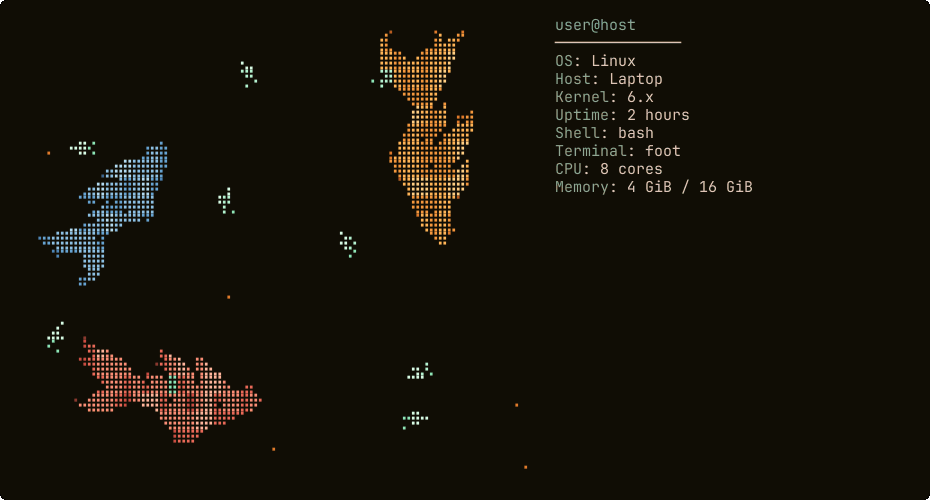

# Koi Fetch

An animated terminal pond where koi swim and hunt tiny food creatures. By
default, the pond appears beside your existing Fastfetch information.



The preview is rendered from the pond simulation with sample system information.

## Install

Requires Python 3.9 or newer and an ANSI-compatible terminal with a font that
supports Unicode Braille. The terminal palette mode works with standard ANSI
colours; classic and Omarchy palettes use true colour. Koi Fetch is designed
for Linux, macOS and Windows terminals, although not every terminal has been
tested. Fastfetch is needed for the default mode; Omarchy is optional.

Clone and install with [pipx](https://pipx.pypa.io/):

```sh
git clone https://github.com/Kevin-Ebrahim/koi-fetch.git
cd koi-fetch
pipx install .
```

Or install directly from the repository:

```sh
pipx install git+https://github.com/Kevin-Ebrahim/koi-fetch.git
```

Alternatively, run directly from the checkout on Linux or macOS:

```sh
PYTHONPATH=src python3 -m koi_fetch
```

## Use

```sh
koi-fetch                            # Pond beside Fastfetch; automatic colours
koi-fetch --fullscreen               # Pond fills the terminal; no Fastfetch needed
koi-fetch --theme classic            # Fixed original colours
koi-fetch --theme terminal           # Follow the terminal's ANSI palette
koi-fetch --theme omarchy            # Follow the active Omarchy theme
koi-fetch --fullscreen --theme classic
koi-fetch --config /path/to/config.jsonc
koi-fetch --help
```

The default `--theme auto` follows Omarchy when its palette is available, and
otherwise uses the terminal's ANSI palette. The latter uses your terminal's
configured colours without querying or modifying its settings. Explicit
`--theme omarchy` reports an error if the active palette is unavailable.

Koi Fetch loads Fastfetch's normal configuration (or the file/preset supplied
with `--config`) and preserves its information and text colours. It replaces
the Fastfetch logo with the pond and arranges the information beside it
regardless of the configured logo position. Other terminal control sequences
in custom module output are ignored. Information is captured once at startup.

Press **Ctrl+C** to leave the pond. The pond responds to terminal resizing.
When the information is too long for the screen, it wraps and automatically
cycles through pages; empty lines are compacted when space is limited. Very
small terminals display the required minimum size instead.

## Development

```sh
python -m pip install .
python -m unittest discover -s tests
```

Run these commands in a virtual environment. The CI workflow is configured to
check Linux, macOS and Windows with several Python versions; terminal display
support also depends on the terminal and font.

`src/koi_fetch/data/koi-sprite.pgm` is bundled with the package.
`koi-source.png` is the source artwork used to make that sprite.

## Attribution

Koi steering, hunting and spine motion are adapted from
[ascii-sharks](https://github.com/stackedlol/ascii-sharks) by drewdi. Its MIT
license is included in [ASCII-SHARKS-LICENSE](ASCII-SHARKS-LICENSE). Koi Fetch
is released under the [MIT License](LICENSE).
